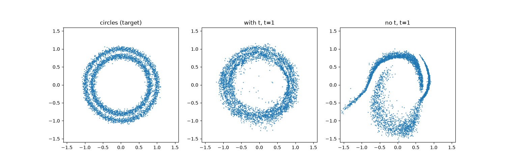

# Flow Matching When the Model Does Not Get t

This document tells what occurs when the velocity model gets a fake `t` (`fake_t = 0`) instead of the real `t`.

## 1. Notation

The notation agrees with `OTFlowMatchingTrainer` in `src/generative_models/trainer/flow_matching.py`.

- $x$ is a source point (moons). $z$ is a target point (circles). The dataset pairs them at random, so $x$ and $z$ are independent.
- $t \sim \mathcal{U}(0, 1)$.
- $x_t = t z + (1 - t) x$.
- The regression target is $z - x$.
- $y$ is a location in the plane.

This setup is I-CFM (independent coupling conditional flow matching) with $\sigma = 0$ in Tong et al. (2024), Section 3.2.2.

The loss is:

$$
\mathcal{L}(f) = \mathbb{E}_{t, x, z} \left\| f(x_t, \cdot) - (z - x) \right\|^2
$$

## 2. The Best Model With t

The best model with $t$ is the conditional mean of the target:

$$
u^*(y, t) = \mathbb{E}\left[ z - x \mid x_t = y,\ t \right]
$$

This is the marginal velocity field. Theorem 3.1 of Tong et al. (2024) shows that this field moves the source distribution to the target distribution along the path $p_t$. That theorem extends Theorem 1 of Lipman et al. (2023) to a condition on the pair $(x, z)$.

## 3. The Best Model Without t

The best model without $t$ can use only the location $y$. Thus its best value is the conditional mean with $t$ also random:

$$
v^*(y) = \mathbb{E}\left[ z - x \mid x_t = y \right]
= \int_0^1 u^*(y, t)\, p(t \mid x_t = y)\, dt
$$

Because $t \sim \mathcal{U}(0, 1)$, the time weight is:

$$
p(t \mid x_t = y) = \frac{p_t(y)}{\int_0^1 p_s(y)\, ds}
$$

Thus $v^*$ is a weighted average of $u^*$ over time. The weight is high at the times when many paths go through $y$.

## 4. The Extra Loss

The loss without $t$ is higher by this quantity:

$$
\mathcal{L}(v^*) - \mathcal{L}(u^*) = \mathbb{E}_{t, x_t} \left\| u^*(x_t, t) - v^*(x_t) \right\|^2
$$

The reason: write $z - x - v^* = (z - x - u^*) + (u^* - v^*)$. The cross term is zero, because $\mathbb{E}[z - x - u^*(x_t, t) \mid x_t, t] = 0$.

Result: $v^* = u^*$ on the paths only if $u^*(y, t)$ does not change with $t$ at each location $y$. If $u^*$ changes with $t$, the loss without $t$ is always higher.

## 5. What the Flow Does Without t

The sampler solves this ordinary differential equation (ODE):

$$
\frac{dy}{dt} = v(y)
$$

The right side does not contain $t$. This has these results:

1. **One location, one velocity.** A particle at $y$ always gets the same velocity. The time of arrival at $y$ has no effect.
2. **Trajectories cannot cross.** The MLP uses ReLU (rectified linear unit) layers, so $v$ is Lipschitz. Thus the solution through each point is unique. If two particles touch the same point, they then follow the same path.
3. **The same rule in each half.** Let $\Phi_s$ be the flow map for duration $s$. Then $\Phi_1 = \Phi_{1/2} \circ \Phi_{1/2}$. With $t$, the map for $[0, 1/2]$ and the map for $[1/2, 1]$ can be different.
4. **No guarantee for the result.** The theorem in Section 2 applies to $u^*$, not to $v^*$. Thus the points at $t = 1$ do not always have the distribution of $z$.

### Moons to circles

At $t = 0$, $x_0 = x$ and $z$ is independent of $x$. Thus:

$$
u^*(y, 0) = \mathbb{E}[z] - y
$$

The circles have their center at the origin, so $\mathbb{E}[z] = 0$. Thus, with $t$, all points first move in to the center. Then they move out to the two rings.

Without $t$, one location must have one velocity for "move in" (early $t$) and for "move out" (late $t$). The model learns only the weighted average of the two.

## 6. Test Results

Script: `agent-workspace/check_ot_fm_no_t.py`. The two models have the same architecture and training (10000 steps, lr = 1e-3, batch 1000). Only the `t` input is different.

Note: `make_moons` and `make_circles` do not have a fixed seed. Thus the numbers change a little between runs.

| Quantity | With t | Without t |
|---|---|---|
| Loss on 400000 new samples | 1.00 | 1.55 |
| Mean distance from bin average of prediction to bin average of target (40 x 40 grid) | 0.075 | 0.072 |
| Mean spread (std) of the predictions in one bin | 0.74 | 0.03 |
| Chamfer distance of generated points to circles (lower is better) | 0.013 | 0.048 |
| Mean radius at t = 0, 0.5, 1 | 1.05, 0.65, 0.91 | 1.05, 0.86, 0.89 |

Reference values:

- Mean length of the target in one bin: 0.58.
- Chamfer distance of circles to new circles samples (best possible): 0.010.
- Chamfer distance of moons to circles (no movement): 0.205.
- Section 4 check: loss gap = 0.55. Measured $\mathbb{E}\|u - v\|^2$ = 0.58.

What the results show:

- Both models agree with the bin average of the target. But the model with $t$ gives many different velocities at one location (std 0.74). The model without $t$ gives one velocity (std 0.03). This agrees with Section 3.
- In 2D, the location $x_t$ does not tell the value of $t$. Thus the loss without $t$ stays higher.
- With $t$, the mean radius goes down to 0.65 and then up to 0.91 (in, then out). Without $t$, the radius changes much less.

Left: target circles. Center: model with $t$ at $t = 1$. Right: model without $t$ at $t = 1$. The model without $t$ does not make two rings.

## 7. High Dimensions

Sun et al. (2025) study the same question for image models. They also write the target without $t$ as an average over $p(t \mid x_t)$.

For Gaussian noise paths, they show that $p(t \mid x_t)$ is narrow when the dimension $d$ is large: $\mathrm{Var}[t] \approx t_*^2 / (2d)$, if $1/d \ll t_*$. Thus, in high dimensions, $x_t$ itself tells the value of $t$.

On CIFAR-10, flow matching (FM, 1-rectified flow) with 100 Euler steps has FID (Fréchet Inception Distance) 3.01 with $t$ and 2.61 without $t$.

In this 2D test, $d = 2$. Thus $x_t$ does not tell $t$, and the model without $t$ fails.

## References

- Lipman et al., *Flow Matching for Generative Modeling*, ICLR 2023. https://arxiv.org/abs/2210.02747
- Tong et al., *Improving and Generalizing Flow-Based Generative Models with Minibatch Optimal Transport*, TMLR 2024. https://arxiv.org/abs/2302.00482
- Sun, Jiang, Zhao, He, *Is Noise Conditioning Necessary for Denoising Generative Models?*, ICML 2025. https://arxiv.org/abs/2502.13129
