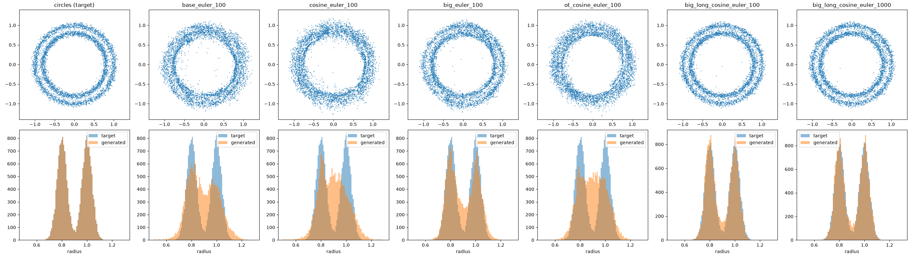

# OT Flow Matching From Moons to Circles: Why the Circles Are Not Sharp

This document tells why `OTFlowMatchingTrainer` gives circles that are not sharp, and which changes make them better. All results come from tests in `agent-workspace/`.

## 1. Summary

The base setup has three problems. Each problem has a different cause.

| Problem | Cause | Fix that the tests show |
|---|---|---|
| All points move off center by about 0.055. | The learning rate is constant, and the gradients have much noise. | Cosine learning-rate decay. Optimal transport (OT) pairs also help. |
| The gap between the two rings fills with points. | The model is too small, and the training is too short. | A wider model (256), more steps (50000) and cosine decay. For the wide model, each change alone helps in all 3 seeds, but both together help much more. |
| With a good model, 100 Euler steps are not sufficient. | Random pairs make curved paths. | 1000 Euler steps, or OT pairs (straight paths). |

With a wider model, more steps and cosine decay, the result is close to the best possible value (see Section 3).

## 2. Setup

- Base: `OTFlowMatchingTrainer`, `FlowMatchingMLP(2, [64, 64, 64, 2])`, 10000 steps, batch 1000, learning rate 1e-3 (constant), AdamW.
- `MoonsCirclesDataset` pairs moons and circles at random. Thus the trainer is I-CFM (independent coupling conditional flow matching) with $\sigma = 0$ (Tong et al. 2024, Section 3.2.2). The word "OT" in the trainer name refers to the straight path between the two points of a pair. It does not refer to the pairs.
- Each test changes one or more settings from the base. Most tests use one training seed (`torch.manual_seed(0)`, `np.random.seed(0)`). The four wide-model tests also use seeds 1 and 2 (Section 3.1). The evaluation points are the same for all seeds.
- The seed noise depends on the setup (Section 3.1). For the radius W1 with 1000 steps, the standard deviation between seeds is 0.0035 with a constant learning rate, and 0.0005 to 0.0015 with cosine decay. Thus, for the one-seed tests, a difference of a few 0.001 can come from the seed.

Metrics (lower is better). Each metric compares 20000 generated points with 20000 new circle points.

- **Radius W1:** the Wasserstein-1 distance between the radius distributions. It measures how sharp the rings are.
- **Sliced W1:** the mean Wasserstein-1 distance over 256 random 1D projections. It measures the full 2D distribution, for example a shift.
- **Floor:** the same metric between two independent circle samples. This is the best possible value.

## 3. Results

Values are for 100 / 1000 uniform Euler steps, with seed 0.

| Test | Change from base | Radius W1 | Sliced W1 | Mean of points (100 steps) |
|---|---|---|---|---|
| base | none | 0.0199 / 0.0190 | 0.0367 / 0.0363 | (0.044, -0.033) |
| cosine | cosine decay | 0.0228 / 0.0225 | 0.0091 / 0.0094 | (-0.004, -0.001) |
| long | 50000 steps | 0.0132 / 0.0161 | 0.0177 / 0.0191 | (0.015, -0.002) |
| big | width 256 | 0.0088 / 0.0091 | 0.0263 / 0.0273 | (0.036, -0.014) |
| big_cosine | width 256, cosine decay | 0.0082 / 0.0067 | 0.0061 / 0.0050 | (-0.001, 0.001) |
| big_long | width 256, 50000 steps | 0.0046 / 0.0083 | 0.0153 / 0.0158 | (-0.002, 0.017) |
| long_cosine | 50000 steps, cosine decay | 0.0104 / 0.0093 | 0.0072 / 0.0068 | (-0.002, 0.000) |
| big_long_cosine | width 256, 50000 steps, cosine decay | **0.0055 / 0.0017** | **0.0050 / 0.0036** | (0.000, -0.001) |
| ot | OT pairs | 0.0158 / 0.0158 | 0.0107 / 0.0108 | (0.000, -0.011) |
| ot_cosine | OT pairs, cosine decay | 0.0201 / 0.0201 | 0.0065 / 0.0065 | (0.001, 0.000) |
| floor | two circle samples | 0.0011 | 0.0018 | (0.000, 0.000) |

Top row: points at $t = 1$. Bottom row: radius histograms (blue: target, orange: generated).

### 3.1 Wide model with three seeds

Values are for 1000 Euler steps. Each column is one training seed.

| Test | Radius W1, seeds 0 / 1 / 2 | Radius W1, mean ± std | Sliced W1, seeds 0 / 1 / 2 | Sliced W1, mean ± std |
|---|---|---|---|---|
| big | 0.0091 / 0.0139 / 0.0158 | 0.0129 ± 0.0035 | 0.0273 / 0.0379 / 0.0217 | 0.0289 ± 0.0082 |
| big_cosine | 0.0067 / 0.0067 / 0.0093 | 0.0076 ± 0.0015 | 0.0050 / 0.0052 / 0.0062 | 0.0055 ± 0.0007 |
| big_long | 0.0083 / 0.0036 / 0.0104 | 0.0074 ± 0.0035 | 0.0158 / 0.0094 / 0.0178 | 0.0143 ± 0.0044 |
| big_long_cosine | 0.0017 / 0.0026 / 0.0025 | 0.0023 ± 0.0005 | 0.0036 / 0.0039 / 0.0036 | 0.0037 ± 0.0002 |

What the results show:

- Each change alone helps. For each seed, big_cosine and big_long have a lower radius W1 and a lower sliced W1 than big.
- Both changes together help much more. For each seed, big_long_cosine is better than big_cosine and big_long.
- Cosine decay makes the result much less dependent on the seed. The standard deviation of the radius W1 goes from 0.0035 to 0.0015 (big → big_cosine) and from 0.0035 to 0.0005 (big_long → big_long_cosine).
- Seed 0 was a good seed for big (0.0091, the mean is 0.0129). Thus the seed-0 table above shows smaller gains than the mean values.
- Three seeds are a small sample. The results show a consistent direction, but they do not give an exact size of each gain.

## 4. Causes

### 4.1 Constant learning rate and noisy gradients: the shift

The random pairs make the regression target $z - x$ very different for pairs that go through the same point at the same time. Thus the gradient has much noise. Tong et al. (2024, Section 5.1) say that OT pairs make training "substantially easier", and they relate this to "the variance reduction of the conditional flow".

With a constant step size, stochastic gradient descent does not stop at the minimum. It stays in a region around the minimum. The size of this region is proportional to the step size (Bottou et al. 2018, Theorem 4.6, for strongly convex problems). Thus the final weights contain noise, and this noise moves all points together.

Test evidence:

- Cosine decay alone removes the shift: sliced W1 0.0367 → 0.0091, and the mean goes from (0.044, -0.033) to (-0.004, -0.001).
- OT pairs alone (constant learning rate) make the shift smaller: sliced W1 0.0367 → 0.0107.
- For the small model, cosine decay alone does not make the rings sharper (radius W1 0.0199 → 0.0228).
- For the wide model with 50000 steps, cosine decay makes the rings much sharper (1000 steps, mean of 3 seeds): radius W1 0.0074 (big_long) → 0.0023 (big_long_cosine). It also makes the result much less dependent on the seed (Section 3.1). This suggests that the weight noise from a constant learning rate also blurs fine detail, when the model is large enough to learn this detail.

### 4.2 Small model and short training: the gap fills

The gap between the rings appears in $p_t$ only at the end of the path. Script `agent-workspace/ring_gap_vs_t.py` measures the density at the gap ($r = 0.9$) divided by the density at the inner ring ($r = 0.8$). Before the measurement, it divides the radius by $t$:

| t | 0.50 | 0.80 | 0.90 | 0.95 | 0.98 | 1.00 |
|---|---|---|---|---|---|---|
| gap / peak | 1.13 | 0.91 | 1.30 | 0.52 | 0.17 | 0.11 |

Thus the field must put each point on the correct ring in the last 5% of time. The rings are 0.2 apart, and each ring has a noise of 0.04. Thus the field must have fine detail in a small part of space and time.

Test evidence:

- Width 256 makes the rings sharper: radius W1 0.0199 → 0.0088.
- 50000 steps also help: radius W1 0.0199 → 0.0132.
- For the wide model, each change alone helps in all 3 seeds. Mean radius W1 with 1000 steps: big 0.0129, big_cosine 0.0076, big_long 0.0074. Both changes together give 0.0023, which is much better (Section 3.1).
- All three changes together give radius W1 0.0055 (100 steps) and 0.0017 (1000 steps).

### 4.3 Curved paths: 100 Euler steps are not sufficient

Random pairs make curved paths. In the earlier test (`human-docs/flow-matching-without-t.md`), the mean radius goes from 1.05 to 0.65 and then to 0.91. Thus the points first move in to the center, and then move out to the rings.

Test evidence:

- For the small models, 100 and 1000 steps give almost the same result. The model error is larger than the solver error.
- For big_long_cosine, 1000 steps are much better than 100 steps: radius W1 0.0055 → 0.0017.
- For models with a constant learning rate, 1000 steps were worse than 100 steps in some runs: long (seed 0) 0.0132 → 0.0161, big_long (seed 0) 0.0046 → 0.0083. For big_long with seeds 1 and 2, 1000 steps were better (0.0075 → 0.0036, 0.0137 → 0.0104). The 1000-step result is closer to the exact solution of the model's ordinary differential equation (ODE). Thus, with 100 steps, the solver error moved the points closer to the target by chance. Use the 1000-step values to compare the models.
- With OT pairs, 100 and 1000 steps give the same result (0.0158 / 0.0158). Thus the paths are almost straight. Tong et al. (2024, Section 5.3, CIFAR-10) also find that OT pairs give "straighter, easily integrable flows" and better results with few function evaluations.

### 4.4 Where the solver error is

Script `agent-workspace/eval_time_grids.py` uses the big_long_cosine model with different Euler time grids. A grid with a fixed number of steps cannot make all steps smaller. If it makes the steps at one part smaller, it must make the steps at other parts larger. Thus the test also adds extra small steps without a change to the other steps.

| Grid | Steps | First step | Last step | Radius W1 | Sliced W1 |
|---|---|---|---|---|---|
| Uniform | 100 | 0.010 | 0.010 | 0.0055 | 0.0050 |
| Small steps at end, larger at start ($t_i = 1 - (1 - i/100)^2$) | 100 | 0.020 | 0.0001 | 0.0069 | 0.0059 |
| Small steps at start, larger at end ($t_i = (i/100)^2$) | 100 | 0.0001 | 0.020 | 0.0070 | 0.0060 |
| Uniform, last 10 steps split into 10 each | 190 | 0.010 | 0.001 | 0.0050 | 0.0048 |
| Uniform, first 10 steps split into 10 each | 190 | 0.001 | 0.010 | 0.0048 | 0.0054 |
| Uniform, middle 80 steps split into 10 each | 820 | 0.010 | 0.010 | 0.0032 | 0.0036 |
| Uniform | 1000 | 0.001 | 0.001 | 0.0017 | 0.0036 |

What the results show:

- Extra small steps at the end or at the start help a little. They do not make the result worse.
- With 100 steps, a move of small steps to one end makes the result worse. The steps in the middle and at the other end become larger.
- Smaller steps in the middle give most of the gain. Thus, in this test, the largest solver error is in the middle of the path. This agrees with the curved paths in Section 4.3: the points turn from "move in" to "move out" between $t = 0.5$ and $t = 0.6$.

## 5. Changes That Did Not Help

| Test | Change | Radius W1 | Sliced W1 |
|---|---|---|---|
| cosine_tskew | cosine decay, $t = 1 - (1 - u)^2$ (more training samples near $t = 1$) | 0.0208 / 0.0201 | 0.0107 / 0.0106 |
| big_long_cosine_tskew | big_long_cosine with the same $t$ distribution | 0.0065 / 0.0024 | 0.0063 / 0.0046 |

More training samples near $t = 1$ did not help. With the big model, the result was worse.

## 6. Cost of OT Pairs

`MinibatchOTTrainer` in `agent-workspace/diagnose_ot_fm_circles.py` pairs the points with the Hungarian algorithm (`scipy.optimize.linear_sum_assignment`) on squared distances.

- One batch of 1000 moons and circles points takes 0.30 s. Thus 10000 steps take about 50 minutes.
- The test splits each batch of 1000 into 4 OT sub-batches of 250. Each sub-batch takes about 0.008 s.
- Tong et al. (2024, Section 3.2.3) say: "The OT batch size need not match the optimization batch size". In their ablation (Appendix D), the path energy stops getting better at an OT batch of about 64.

Not tested: OT pairs together with width 256, 50000 steps and cosine decay.

## 7. Files

- `agent-workspace/diagnose_ot_fm_circles.py`: trains and measures all tests. Usage: `[SEED=n] python diagnose_ot_fm_circles.py OUT_DIR EXP [EXP ...]`. `SEED` sets the training seed (default 0).
- `agent-workspace/plot_ot_fm_circles.py`: makes the plot in Section 3.
- `agent-workspace/ring_gap_vs_t.py`: the table in Section 4.2.
- `agent-workspace/eval_time_grids.py`: the table in Section 4.4. Usage: `python eval_time_grids.py OUT_DIR big_long_cosine 256`. It needs the model file that `diagnose_ot_fm_circles.py` saves.

## References

- Tong et al., *Improving and Generalizing Flow-Based Generative Models with Minibatch Optimal Transport*, TMLR 2024. https://arxiv.org/abs/2302.00482
- Bottou, Curtis, Nocedal, *Optimization Methods for Large-Scale Machine Learning*, SIAM Review 2018. https://arxiv.org/abs/1606.04838
