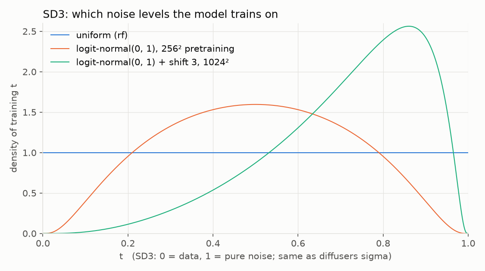

# The Noise Schedule in SD3

The words "noise schedule" can refer to three different parts of SD3:

1. **The noise path:** how SD3 mixes data and noise at each time $t$.
2. **The training distribution of $t$:** which noise levels the model trains on.
3. **The sampling grid:** where the sampler takes its steps.

| Part | SD3 choice |
|---|---|
| Noise path | Rectified flow: $z_t = (1 - t)\, x_0 + t\, \epsilon$ |
| Training $t$, 256×256 pretraining | Logit-normal with $m = 0$, $s = 1$ |
| Training $t$, 1024×1024 finetuning | Logit-normal(0, 1), then shift 3. This is equal to logit-normal($\log 3 \approx 1.10$, 1). |
| Sampling | Euler steps on a uniform grid. At 1024×1024, the grid has shift 3. |

## 1. The Noise Path

SD3 writes the forward process as $z_t = a_t x_0 + b_t \epsilon$, with $\epsilon \sim \mathcal{N}(0, I)$. For rectified flow, SD3 uses:

$$
z_t = (1 - t)\, x_0 + t\, \epsilon
$$

- $t = 0$ is clean data. $t = 1$ is pure noise.
- This $t$ is the same as `sigma` in the diffusers sampler (see `human-docs/sigma-shift.md`).
- `GaussianOTFlowMatchingTrainer` in this repo uses the same path with the opposite time direction: $t_{\text{repo}} = 1 - t_{\text{SD3}}$.

SD3 defines the signal-to-noise ratio as $\lambda_t := \log(a_t^2 / b_t^2)$. For rectified flow:

$$
\lambda_t = 2 \log \frac{1 - t}{t} = -2\, \mathrm{logit}(t)
$$

SD3 compares this path with other formulations, for example "eps/linear". About that baseline, SD3 says: "LDM (Rombach et al., 2022) uses a modification of the DDPM schedule (Ho et al., 2020). Both are variance preserving schedules".

## 2. The Training Distribution of t

### 2.1 Logit-normal sampling

Rectified flow with uniform $t$ is called "rf" in SD3. SD3 also tests other distributions of $t$. The logit-normal density is:

$$
\pi_{\ln}(t; m, s) = \frac{1}{s \sqrt{2\pi}} \frac{1}{t (1 - t)} \exp\left( -\frac{(\mathrm{logit}(t) - m)^2}{2 s^2} \right)
$$

SD3 says: "In practice, we sample the random variable u from a normal distribution u ∼ 𝒩(u; m, s) and map it through the standard logistic function."

SD3 chose $m = 0$, $s = 1$: "We observe that rf/lognorm(0.00, 1.00) consistently achieves a good rank. It outperforms a rectified flow formulation with uniform timestep sampling (rf) and thus confirms our hypothesis that intermediate timesteps are more important."

### 2.2 Pretraining and finetuning

- SD3 says: "we pretrain all of our models on low-resolution images of size 256² pixels. Next, we finetune our models on higher resolutions with mixed aspect ratios".
- At 1024×1024, SD3 says: "In our subsequent experiments, we thus use a shift value of α = 3.0 both during training and sampling at resolution 1024 × 1024."
- The scaling section of SD3 does not repeat which distribution of $t$ it used. It says: "all previous considerations of diffusion formulations, architectures, and data culminate in the last section, where we scale our models up to 8B parameters."

### 2.3 Logit-normal with a shift is a logit-normal

The shift with value $s$ is $t' = \frac{s\, t}{1 + (s - 1)\, t}$. Then:

$$
\mathrm{logit}(t') = \mathrm{logit}(t) + \log s
$$

Thus, if $t$ is logit-normal($m$, $\sigma$), then $t'$ is logit-normal($m + \log s$, $\sigma$). For SD3 at 1024×1024, the training $t$ is logit-normal($\log 3$, 1), with $\log 3 \approx 1.10$.

Check with 1,000,000 samples (`agent-workspace/plot_sd3_timestep_density.py`):

| Quantity | Measured | Expected |
|---|---|---|
| Mean of $\mathrm{logit}(t')$ | 1.0996 | 1.0986 |
| Standard deviation of $\mathrm{logit}(t')$ | 1.0007 | 1.0 |
| Fraction of training $t > 0.5$, no shift | 0.500 | 0.5 |
| Fraction of training $t > 0.5$, shift 3 | 0.864 | |

In terms of the signal-to-noise ratio, the shift moves $\lambda$ down by the same amount at each $t$. SD3 (Equation 25) writes this as $\lambda_{t_m} = \lambda_{t_n} - 2 \log \alpha$. With shift 3, this is $2 \log 3 \approx 2.2$.

### 2.4 Relation to a loss weight

SD3 (Equation 18) says that a distribution $\pi(t)$ "is equivalent to a weighted loss" with weight $\frac{t}{1 - t} \pi(t)$ in the $\epsilon$-prediction form. In the velocity form, the weight is $\pi(t)$. See `human-docs/sigma-shift.md`, Section 7, for the test of this equivalence and of the gradient noise.

### 2.5 The diffusers SD3 training script

The diffusers script `examples/dreambooth/train_dreambooth_sd3.py` uses the same method:

1. `u = sigmoid(normal(logit_mean, logit_std))`, with defaults `logit_mean = 0.0` and `logit_std = 1.0`.
2. `indices = (u * num_train_timesteps).long()`, then `timesteps = noise_scheduler_copy.timesteps[indices]`. The scheduler makes this table from shifted sigmas (`sigmas = shift * sigmas / (1 + (shift - 1) * sigmas)` in `__init__`).
3. `noisy_model_input = (1.0 - sigmas) * model_input + sigmas * noise`.
4. For `logit_normal`, the loss weight is 1 (`compute_loss_weighting_for_sd3` returns `torch.ones_like(sigmas)`).

Note: the shift value comes from the scheduler config of the model. The SD3 config on Hugging Face needs a login, so this document does not read its value.

## 3. The Sampling Grid

- SD3 uses Euler steps. For the comparison of formulations, SD3 says: "For sampling, we always use a Euler discretization (Euler, 1768) of Equation 1 and six different settings: 50 steps with classifier-free-guidance scales 1.0, 2.5, 5.0, and 5, 10, 25 steps with classifier-free-guidance scale 5.0."
- At 1024×1024, the sampling grid has shift 3. This puts smaller steps at the noise end (see `human-docs/sigma-shift.md`, Section 3).
- The diffusers SD3 pipeline uses 28 steps by default.

## 4. Files

- `agent-workspace/plot_sd3_timestep_density.py`: makes the figure and the check in Section 2.3. Usage: `python plot_sd3_timestep_density.py OUT_PNG`.

## References

- Esser et al., *Scaling Rectified Flow Transformers for High-Resolution Image Synthesis* (SD3), 2024. https://arxiv.org/abs/2403.03206
- diffusers, `train_dreambooth_sd3.py`. https://github.com/huggingface/diffusers/blob/main/examples/dreambooth/train_dreambooth_sd3.py
- diffusers, `training_utils.py` (`compute_density_for_timestep_sampling`, `compute_loss_weighting_for_sd3`). https://github.com/huggingface/diffusers/blob/main/src/diffusers/training_utils.py
- diffusers, `FlowMatchEulerDiscreteScheduler`. https://github.com/huggingface/diffusers/blob/main/src/diffusers/schedulers/scheduling_flow_match_euler_discrete.py
