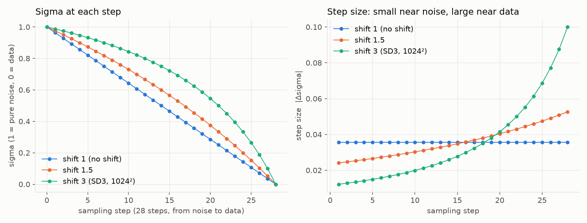
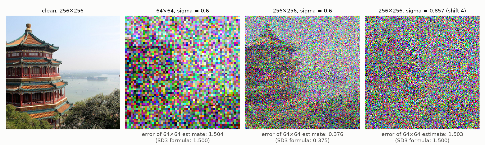

# The Shifted Sigma Schedule in SD3 and FLUX

This document tells what `sigmas` is in the diffusers flow-matching sampler, what the shift does, and why SD3 and FLUX use it.

## 1. What Sigma Is

`FlowMatchEulerDiscreteScheduler` in diffusers adds noise with this line (`scale_noise`, line 234):

```python
sample = sigma * noise + (1.0 - sigma) * sample
```

- $\sigma = 1$ is pure noise. $\sigma = 0$ is clean data.
- `GaussianOTFlowMatchingTrainer` in this repo uses `xt = t * z + (1 - t) * epsilon`. Thus $\sigma = 1 - t$. The diffusers time runs in the opposite direction.
- SD3 writes the same path as $z_t = (1 - t)\, x_0 + t\, \epsilon$. Thus the SD3 $t$ is the diffusers $\sigma$.

## 2. How the Sampler Makes the Sigmas

For $N$ sampling steps, the FLUX pipeline does these steps (SD3 is almost the same):

1. Make $N$ even values from 1 to $1/N$ (`np.linspace(1.0, 1 / num_inference_steps, num_inference_steps)`).
2. Apply the shift (Section 3).
3. Add $\sigma = 0$ at the end.

The Euler step goes from $\sigma$ to the next value $\sigma'$:

```python
dt = sigma_next - sigma            # negative
prev_sample = sample + dt * model_output
```

The default in the SD3 and FLUX pipelines is `num_inference_steps = 28`.

## 3. The Shift

The shift with value $s$ changes each sigma:

$$
\sigma' = \frac{s\, \sigma}{1 + (s - 1)\, \sigma}
$$

In diffusers: `sigmas = shift * sigmas / (1 + (shift - 1) * sigmas)`.



Left: sigma at each of the 28 steps. Right: the step size.

| Shift | First step | Last step | Steps with $\sigma > 0.5$ |
|---|---|---|---|
| 1 (no shift) | 0.036 | 0.036 | 14 of 28 |
| 1.5 | 0.024 | 0.053 | 17 of 28 |
| 3 (SD3 at 1024×1024) | 0.012 | 0.100 | 21 of 28 |

What the shift does:

- The end points do not change: $\sigma = 1$ stays 1, and $\sigma = 0$ stays 0.
- Near the noise end, the steps become smaller. The slope of the shift at $\sigma = 1$ is $1/s$.
- Near the data end, the steps become larger. The slope at $\sigma = 0$ is $s$.
- The number of steps does not change. Thus the shift moves steps from the data end to the noise end.

## 4. Why: High Resolution Needs More Noise

SD3 (Section 5.3.2) says: "Since higher resolutions have more pixels, we need more noise to destroy their signal."

### 4.1 The constant-image argument

SD3 uses an image where each pixel has the same value $c$. With noise level $t$, each of the $n$ pixels is one noisy observation of $c$:

$$
z_t = (1 - t)\, c\, \mathbb{1} + t\, \epsilon
$$

The mean of the $n$ pixels, divided by $(1 - t)$, estimates $c$. The standard deviation of this estimate is:

$$
\sigma(t, n) = \frac{t}{1 - t} \sqrt{\frac{1}{n}}
$$

More pixels give more observations. Thus, at the same $t$, a large image has less uncertainty than a small image.

### 4.2 The same uncertainty at two resolutions

SD3 sets $\sigma(t_n, n) = \sigma(t_m, m)$ for resolutions with $n$ and $m$ pixels. The result:

$$
t_m = \frac{\alpha\, t_n}{1 + (\alpha - 1)\, t_n}, \qquad \alpha = \sqrt{m / n}
$$

This is the shift formula of Section 3 with $s = \alpha$. Thus the shift gives the high-resolution model the same uncertainty at each step as the low-resolution model.

Example: from 64×64 to 256×256, $m / n = 16$, so $\alpha = 4$.

### 4.3 Test with a real image

Script `agent-workspace/plot_sigma_shift.py` adds noise to a 256×256 image and to the same image at 64×64 (4×4 average pool). It then measures the error of the 64×64 estimate: average pool to 64×64, divide by $(1 - \sigma)$, compare with the clean 64×64 image.



| Image | Sigma | Measured error | SD3 formula |
|---|---|---|---|
| 64×64 | 0.6 | 1.504 | 1.500 |
| 256×256 | 0.6 | 0.376 | 0.375 |
| 256×256 | 0.857 (shift 4 of 0.6) | 1.503 | 1.500 |

- At the same sigma (0.6), the 256×256 image keeps much more of the picture. The pagoda is easy to see.
- With the shifted sigma (0.857), the 256×256 image has the same error as the 64×64 image at 0.6.

Note: SD3 and FLUX apply the shift to latents, not pixels. Thus $n$ is the number of latent positions. The test uses pixels to show the same effect.

### 4.4 What goes wrong without the shift

The test in Section 4.3 shows that a 256×256 image at $\sigma = 0.6$ still shows its large shapes, and its error is 4 times lower than at 64×64. Thus, at high resolution, the large shapes are already almost fixed at a middle sigma. Only the steps at high sigma can decide them.

A uniform grid puts only 14 of 28 steps at $\sigma > 0.5$. Shift 3 puts 21 of 28 steps there (Section 3).

Movie Gen gives a similar reason for its own schedule: "the first inference steps are pivotal in setting up the scene and motion of the video".

## 5. How SD3 Chose the Value 3.0

The formula gives $\alpha = \sqrt{m / n}$. But SD3 chose the value with a human study. SD3 says that they "apply them to the sampling steps of a model trained at resolution 1024×1024 and run a human preference study". The result was a "strong preference for shifts greater than 1.5 but less drastic differences among higher shift values". Thus SD3 uses "a shift value of α=3.0 both during training and sampling at resolution 1024×1024".

Thus the shift has two effects in SD3:

1. **Training:** more training samples at high noise levels.
2. **Sampling:** smaller steps at high noise levels.

## 6. FLUX: A Shift That Depends on Image Size

FLUX uses the same formula with $s = e^{\mu}$. The diffusers code uses `math.exp(mu) / (math.exp(mu) + (1 / t - 1) ** sigma)` with `sigma = 1.0`. This is equal to the formula in Section 3 with $s = e^{\mu}$.

The pipeline calculates $\mu$ from the number of image tokens (`calculate_shift`). $\mu$ is linear in the token count, from 0.5 at 256 tokens to 1.15 at 4096 tokens (pipeline defaults):

| Tokens | $\mu$ | Shift $s = e^{\mu}$ |
|---|---|---|
| 256 | 0.50 | 1.65 |
| 1024 | 0.63 | 1.88 |
| 4096 | 1.15 | 3.16 |

The FLUX pipeline packs the latent into 2×2 patches. If the VAE makes each side 8 times smaller, a 1024×1024 image gives 64×64 = 4096 tokens. Then the shift is 3.16, which is close to the SD3 value of 3.0.

Note: the FLUX scheduler config on Hugging Face needs a login. Thus the values above are the defaults in the diffusers pipeline code, not values read from the FLUX config.

## 7. In Training, Is the Shift a Loss Weight?

This section is about training only.

### 7.1 Yes, in expectation

In training, the shift changes the distribution of the noise level. If $u \sim \mathcal{U}(0, 1)$ and $\sigma = \frac{s u}{1 + (s - 1) u}$, the density of $\sigma$ is:

$$
q(\sigma) = \frac{s}{\left(s - (s - 1)\sigma\right)^2}
$$

For any loss $L(\sigma)$:

$$
\mathbb{E}_{\sigma \sim q}\left[L(\sigma)\right] = \mathbb{E}_{\sigma \sim \mathcal{U}(0,1)}\left[q(\sigma)\, L(\sigma)\right]
$$

Thus a shifted noise level with a plain loss has the same expected loss and the same expected gradient as a uniform noise level with the loss weight $w(\sigma) = q(\sigma)$. For $s = 3$, the weight is 3 at $\sigma = 1$ (noise) and $1/3$ at $\sigma = 0$ (data).

SD3 (Section 3.1) says the same: "changing the distribution over t from the commonly used uniform distribution to a distribution with density π(t) is equivalent to a weighted loss ℒ_w with w_t^π = (t/(1−t))π(t)". The factor $t/(1-t)$ occurs because SD3 writes all losses in the $\epsilon$-prediction form. In the velocity form of this repo, the weight is $\pi(t)$.

### 7.2 But the gradient noise is different

The two methods have the same expected gradient, but not the same variance. Kingma and Gao (2023, Section 3.2) say: "The noise schedule still affects the variance of this Monte Carlo estimator and its gradients; therefore, the noise schedule affects the efficiency of optimization."

Script `agent-workspace/check_shift_vs_weight.py` measures this on the `GaussianOTFlowMatchingTrainer` setup (noise to moons), with $s = 3$, 2000 batches of 1000:

- **A:** shifted noise level, plain loss.
- **B:** uniform noise level, loss weight $q(\sigma)$.

| Model weights | Mean loss A | Mean loss B | Mean gradient difference / noise level | Cosine of mean gradients | Gradient variance B / A |
|---|---|---|---|---|---|
| Random initialization | 3.2658 ± 0.0022 | 3.2622 ± 0.0031 | 0.0028 / 0.0060 | 1.0000 | 1.57 |
| After 3000 training steps with A | 1.6980 ± 0.0013 | 1.6985 ± 0.0012 | 0.0146 / 0.0155 | 0.9995 | 1.03 |

- The mean losses and the mean gradients agree within the measurement noise.
- B has more gradient noise: 1.57 times at random initialization, 1.03 times after training. B draws the high-noise samples less often than A, but gives them a weight of up to 3. A few samples with a large weight make the gradient noisier.
- This test does not compare the final model quality of A and B.

## 8. The Shift in the MIT 6.S184 Notation

This section does not use the logit-normal distribution. The training $t$ is uniform.

### 8.1 The notation

The MIT 6.S184 labs (`mit-6-s184/MIT 6.S184 lab_two.ipynb`) use a Gaussian conditional path:

$$
p_t(x \mid z) = \mathcal{N}(x;\ \alpha_t z,\ \beta_t^2 I_d), \qquad \alpha_0 = \beta_1 = 0, \quad \alpha_1 = \beta_0 = 1
$$

Here $t = 0$ is noise and $t = 1$ is data. Thus $x = \alpha_t z + \beta_t \epsilon$. The lab calculates the conditional vector field as:

$$
u_t(x \mid z) = \left(\dot\alpha_t - \frac{\dot\beta_t}{\beta_t} \alpha_t\right) z + \frac{\dot\beta_t}{\beta_t}\, x
$$

The CondOT path of this repo (`GaussianOTFlowMatchingTrainer`) is $\alpha_t = t$, $\beta_t = 1 - t$.

### 8.2 The equivalent $\alpha_t$ and $\beta_t$

SD3 samples $u \sim \mathcal{U}(0, 1)$ and uses the noise level $\sigma = \frac{s u}{1 + (s - 1) u}$, with $x = (1 - \sigma)\, z + \sigma\, \epsilon$. In the 6.S184 direction, put $t = 1 - u$, which is also uniform. Then $\beta_t = \sigma$ and $\alpha_t = 1 - \sigma$:

$$
\alpha_t = \frac{t}{s - (s - 1)\, t}, \qquad \beta_t = \frac{s\, (1 - t)}{s - (s - 1)\, t} = 1 - \alpha_t
$$

For $s = 3$: $\alpha_t = \frac{t}{3 - 2t}$ and $\beta_t = \frac{3 (1 - t)}{3 - 2t}$. For $s = 1$, this is the CondOT path ($\alpha_t = t$, $\beta_t = 1 - t$).

### 8.3 What this path is

- $\alpha_t + \beta_t = 1$. Thus each sample moves on the same straight line from $\epsilon$ to $z$ as with CondOT. Only the speed on the line changes.
- The speed is $\dot\alpha_t = \frac{s}{(s - (s - 1)\, t)^2}$. For $s = 3$, it is $1/3$ at $t = 0$ (noise), $0.75$ at $t = 0.5$, and $3$ at $t = 1$ (data). Thus the sample moves slowly near the noise end. With uniform $t$, more training samples are near the noise end.
- Because $\dot\beta_t = -\dot\alpha_t$, the lab formula gives $u_t(x \mid z) = \dot\alpha_t\, (z - \epsilon)$. This is the CondOT target $z - \epsilon$, multiplied by $\dot\alpha_t$.

### 8.4 The loss is not the same as in SD3

With this path, the plain loss of the lab is:

$$
\mathbb{E}_{t \sim \mathcal{U}(0,1)} \left\| u^\theta_t(x) - \dot\alpha_t (z - \epsilon) \right\|^2
$$

The noise levels have the same distribution as in SD3. But the target is $\dot\alpha_t$ times the SD3 target $z - \epsilon$. If the network output is $u^\theta_t = \dot\alpha_t\, v^\theta$, the loss becomes $\dot\alpha_t^2 \left\| v^\theta - (z - \epsilon) \right\|^2$. Thus, compared with SD3, the lab loss has an extra weight $\dot\alpha_t^2$. For $s = 3$, this weight goes from $1/9$ at $t = 0$ (noise) to $9$ at $t = 1$ (data). It works against the shift, which puts more samples near the noise end.

To get the SD3 loss with this path, divide the loss by $\dot\alpha_t^2$. Or, train the network to predict $z - \epsilon$.

### 8.5 Numerical check

Script `agent-workspace/check_shift_alpha_beta.py`, with $s = 3$:

| Check | Result |
|---|---|
| Largest quantile difference between $\beta_t$ ($t$ uniform) and the SD3 $\sigma$ (1,000,000 independent samples each) | 0.0014 (sampling noise) |
| $\alpha_t + \beta_t = 1$ | True |
| Largest difference between $\dot\alpha_t$ from autograd and from the formula | $4 \times 10^{-16}$ |
| $\dot\alpha_t$ at $t = 0, 0.5, 1$ | 0.3333, 0.75, 3.0 |
| Largest difference between the lab vector field and $\dot\alpha_t (z - \epsilon)$ | $3 \times 10^{-11}$ |

## 9. Files

- `agent-workspace/plot_sigma_shift.py`: makes both figures. Usage: `python plot_sigma_shift.py OUT_SCHEDULE_PNG OUT_DEMO_PNG`.
- `agent-workspace/check_shift_vs_weight.py`: the test in Section 7.2.
- `agent-workspace/check_shift_alpha_beta.py`: the check in Section 8.5.

## References

- Esser et al., *Scaling Rectified Flow Transformers for High-Resolution Image Synthesis* (SD3), 2024, Section 5.3.2. https://arxiv.org/abs/2403.03206
- diffusers, `FlowMatchEulerDiscreteScheduler`. https://github.com/huggingface/diffusers/blob/main/src/diffusers/schedulers/scheduling_flow_match_euler_discrete.py
- diffusers, FLUX pipeline. https://github.com/huggingface/diffusers/blob/main/src/diffusers/pipelines/flux/pipeline_flux.py
- Polyak et al., *Movie Gen: A Cast of Media Foundation Models*, 2024. https://arxiv.org/abs/2410.13720
- Kingma and Gao, *Understanding Diffusion Objectives as the ELBO with Simple Data Augmentation*, 2023, Section 3.2. https://arxiv.org/abs/2303.00848
